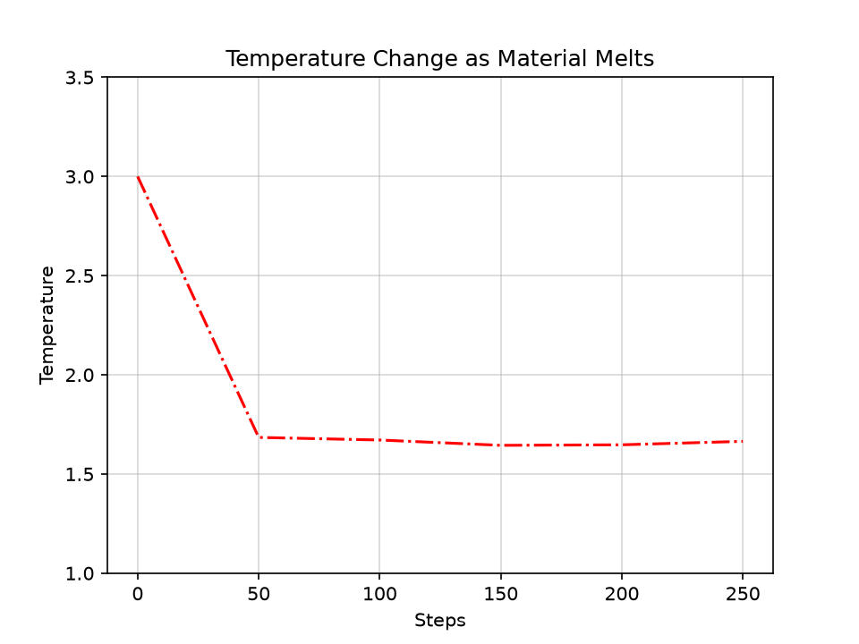

# LAMMPS Project Analysis

## LAMMPS Log Pipeline

### Parsing, Organizing and Plotting LAMMPS Simulations Output with Bash, awk and Python


This project analyzes builds a pipeline that turns raw LAMMPS log files into clean CSV files and plots, and runs with a single command (bash script).

THe simulation logs used in this project come from the sample set distributed with LAMMPS in a LAMMPS Github Repo. The Github repo is as following:


Additionally, The citation for LAMMPS is as follows:

Thompson, A. P., Aktulga, H. M., Berger, R., Bolintineanu, D. S., Brown, W. M., Crozier, P. S., et al. (2022). LAMMPS - a flexible simulation tool for particle-based materials modeling at the atomic, meso, and continuum scales. Comp. Phys. Comm., 271, 108171. DOI: 10.1016/j.cpc.2021.108171

To provide some background, LAMMPS is a molecular dynamics code, and every simulation writes a log file. A log file is not just a table of numbers. It contains the LAMMPS version and setup information, the input commands that were run, one or more thermo tables (Step, Temp, energies, pressure, and so on), and a timing and performance summary at the end. Moreover, the thermo columns are not the same from file to file, and they can even change inside a single file. For example, the minimization box log starts with the columns Step Temp Energy per pair, Energy per mol, Total Energy, Press and later switches to a different set of columns. Therefore, a parser that assumes fixed column positions breaks on real data.

The aim of this project is to build a parser that works from the structure of the file instead. Every thermo block starts at a line beginning with "Step" and ends at the line beginning with "Loop time of...". Each block is written to its own CSV file with its own header, and then the blocks are plotted. The project combines Linux command-line tools (bash,awk) for the file handling and extraction with Python (pandas, matplotlib) for the plotting.

## Project Structure and How to Run

```text
LAMMPS_Project/
├── raw/                               # original LAMMPS log files acquired from LAMMPS Github Repo
├── processed/                         # renamed copies of the logs
├── extracted/                         # one CSV per thermo block
├── plots/                             # generic plots (one per CSV)
│   └── curated_plots/                 # curated plots
├── scripts/                           # bash and Python scripts
├── block_labels.csv                   # description of every thermo block
├── run_pipeline.sh                    # runs the whole pipeline
└── README.md
```

Requirements are Linux or WSL with bash 4+ and awk. Python 3 with pandas and matplotlib and other imports are required too. To run the whole pipeline in bash:

git clone https://github.com/ashaheer1/LAMMPS_Project.git<br>
cd LAMMPS_Project<br>
./run_pipeline.sh<br>

The driver script clears the old outputs, rebuilds everything from raw/, and writes the CSV files to extracted/ and the plots to plots/. The block_labels.csv files is also copied to extracted/ to assist in labeling blocks and while plotting these blocks.


# The Input Data

For this project, I used four serial (1-processor) example logs from the LAMMPS examples of melt, min_box, indent, and indent_min. The trailing .1 in the original filenames is the number of MPI processors that were used for the run, and it is not a file format. I only used the .1 files. 

The simulation data analyzed in this project were generated using example LAMMPS simulations from the official LAMMPS repository:

- [Melt Example](https://github.com/lammps/lammps/tree/develop/examples/melt)
- [Minimization Example](https://github.com/lammps/lammps/tree/develop/examples/min)
- [Indentation Example](https://github.com/lammps/lammps/tree/develop/examples/indent)

Table 1 shows that each log contains.

<table align="center" border="1"> <tr> <th>Log</th> <th>Thermo Blocks</th> <th>What the Blocks Are</th> </tr> <tr> <td><code>melt</code></td> <td>1</td> <td>Simulation of Atomic Melt</td> </tr> <tr> <td><code>indent</code></td> <td>2</td> <td>Block 1 with the indenter, block 2 without the indenter</td> </tr> <tr> <td><code>indent_min</code></td> <td>7</td> <td>Initial minimization with indenter, then six diffeent indenter positions: y = 13.0, 12.5, 12.0, 11.4, 11.2, 11.0</td> </tr> <tr> <td><code>min_box</code></td> <td>8</td> <td>Block 1 melt simulation<br> Block 2 minimize atoms only<br> Block 3 <code>box/relax iso</code> (Pxx = Pyy = 1.5)<br> Block 4 <code>box/relax aniso</code> (1.5)<br> Block 5 <code>box/relax x = 1.0 y = 2.0</code><br> Blocks 6 and 7 same as block 4 with tighter force tolerances<br> Block 8 <code>nreset 100</code> + even tighter force tolerance</td> </tr> </table> <div align="center">

#### Table 1. The four LAMMPS logs and the thermo blocks inside each one

</div>

## Step 1: Organizing the Raw Files

The raw filenames are inconsistent (for example `log.27Nov18.min.box.g++.1` and `log.8Apr21.melt.g++.1`), so the first script, `organize.sh`, copies each file from `raw/` into `processed/` with a clean name (`melt.log`, `indent.log`, `indent_min.log`, `min_box.log`). I used an explicit filename map instead of pattern matching, because pattern matching on inconsistend names is harder and fragile. Adding a new log only needs one new line in the map.

## Step 2: Extracting the Thermo Blocks

The second script, `extract.sh`, loops over every file in `processed/` and used awk to do the extraction. Whenever line starts with Step, a new block begins, awk saves that line as the CSV header and opens a new file. While inside a block, every row is converted from whitespace-separated to comma-separated and written to that file. When a line starting with `Loop time of...` appears, the block is closed. Then it moves on the the next block where it again starts at `Step` and ends at `Loop time of...`. The output is one file per block, named `<log>_block<N>.csv`, for example `min_block_block3.csv`. Because the script only looks for these two markers, it handles the changing in `min_box` and `indent` without any special cases.

## Step 3: Summarizing the Extraction

The third script, `summarize.sh`, is a sanity check of our result so far. For every CSV file in `extracted/` it prints the number of rows, the number of columns, the column names, and the description of that block. This made it easy to confirm that the block counts matched what I counted before and expected from the logs (1 for `melt`, 2 for `indent`, 7 for `indent_min`, and 8 for `min_box`).

## Labeling the Blocks
The extraction step is generic in this case, so it does not know what each block means physically. It merely separates each file into different blocks. This information is thus stored by hand in `block_labels.csv`, with one row per block (log name, block number, description) by reading the original files in `raw/`. For example, `indent_min` block 3 is described as "Indenter y=12.5". The plotting scripts read this file and use the descriptions in titles and labels. This keeps the parser general and puts all the knowledge in one place.

## Step 4: Plotting

### Generic Plots

The first plotting script makes a generic plot for every CSV. it reads the column of each file and plots every column except `Step` against `Step`, with each block description as the title. Since it reads the column names from the file instead of hardcoding them, it makes it easier and it works for every block. This produced one plot per block in `plots/`, and Figure 1 shows an example.

<div align="center"> </div><div align="center">

### Figure 1. Example of a Generic Plot (Every Column vs Step) for the melt block
</div>


### Curated Plots

After the generic plots, I made a set of curated plots for each simulation. These curated plots are thus saved in `plots/curated_plots/`

#### Melt

Figures 2 and 3 show the temperature and the total energy against the `Step` for the melt simulation

<div align="center"> </div><div align="center">

### Figure 2. Temperature vs. Step for the melt simulation
</div>

