# LAMMPS Project Analysis

## LAMMPS Log Pipeline

### Parsing, Organizing and Plotting LAMMPS Simulations Output with bash, awk and Python


This project builds a pipeline that turns raw LAMMPS log files into clean CSV files and plots, and runs with a single command (bash script).

THe simulation logs used in this project come from the sample set distributed with LAMMPS in a LAMMPS Github Repo.


Additionally, the citation for LAMMPS is as follows:

Thompson, A. P., Aktulga, H. M., Berger, R., Bolintineanu, D. S., Brown, W. M., Crozier, P. S., et al. (2022). LAMMPS - a flexible simulation tool for particle-based materials modeling at the atomic, meso, and continuum scales. Comp. Phys. Comm., 271, 108171. DOI: 10.1016/j.cpc.2021.108171

To provide some background, LAMMPS is a molecular dynamics code, and every simulation writes a log file. A log file is not just a table of numbers. It contains the LAMMPS version and setup information, the input commands that were run, one or more thermo tables (Step, Temp, energies, pressure, and so on), and a timing and performance summary at the end. Moreover, the thermo columns are not the same from file to file, and they can even change inside a single file. For example, the minimization box `min_box` log starts with the columns `Step  Temp  E_pair  E_mol  TotEng  Press` and later switches to a different set of columns. Therefore, a parser that assumes fixed column positions breaks on real data.

The aim of this project is to build a parser that works from the structure of the file instead. Every thermo block starts at a line beginning with `Step` and ends at the line beginning with `Loop time of...`. Each block is written to its own CSV file with its own header, and then the blocks are plotted. The project combines Linux command-line tools (bash, awk) for the file handling and extraction with Python (pandas, matplotlib) for the plotting.

## Project Structure and How to Run

```text
LAMMPS_Project/
├── raw/                               # original LAMMPS log files acquired from LAMMPS Github Repo
├── processed/                         # renamed copies of the logs
├── extracted/                         # one CSV per thermo block
├── plots/                             # generic plots (one per CSV)
│   └── curated_plots/                 # curated plots
├── scripts/                           # bash and Python scripts
├── block_labels.csv                   # description of every thermo block
├── run_pipeline.sh                    # runs the whole pipeline
└── README.md
```

Requirements are Linux or WSL with bash 4+ and awk. Python 3 with pandas and matplotlib and other imports are required too. To run the whole pipeline in bash:

```bash
git clone https://github.com/ashaheer1/LAMMPS_Project.git
cd LAMMPS_Project
./run_pipeline.sh
```

The driver script clears the old outputs, rebuilds everything from `raw/`, and writes the CSV files to `extracted/` and the plots to `plots/`. The block_labels.csv file is also copied to extracted/ to assist in labeling blocks and while plotting these blocks.


## The Input Data

For this project, I used four serial (1-processor) example logs from the LAMMPS examples of melt, min_box, indent, and indent_min. The trailing `.1` in the original filenames is the number of MPI processors that were used for the run, and it is not a file format. I only used the `.1` files. 

The simulation data analyzed in this project were generated using example LAMMPS simulations from the official LAMMPS repository:

- [Melt Example](https://github.com/lammps/lammps/tree/develop/examples/melt)
- [Minimization Example](https://github.com/lammps/lammps/tree/develop/examples/min)
- [Indentation Example](https://github.com/lammps/lammps/tree/develop/examples/indent)

Table 1 shows what each log contains.

<table align="center" border="1"> <tr> <th>Log</th> <th>Thermo Blocks</th> <th>What the Blocks Are</th> </tr> <tr> <td><code>melt</code></td> <td>1</td> <td>Simulation of Atomic Melt</td> </tr> <tr> <td><code>indent</code></td> <td>2</td> <td>Block 1 with the indenter, block 2 without the indenter</td> </tr> <tr> <td><code>indent_min</code></td> <td>7</td> <td>Initial minimization with indenter, then six different indenter positions: y = 13.0, 12.5, 12.0, 11.4, 11.2, 11.0</td> </tr> <tr> <td><code>min_box</code></td> <td>8</td> <td>Block 1 melt simulation<br> Block 2 minimize atoms only<br> Block 3 <code>box/relax iso</code> (Pxx = Pyy = 1.5)<br> Block 4 <code>box/relax aniso</code> (1.5)<br> Block 5 <code>box/relax x = 1.0 y = 2.0</code><br> Blocks 6 and 7 same as block 4 with tighter force tolerances<br> Block 8 <code>nreset 100</code> + even tighter force tolerance</td> </tr> </table> <div align="center">

**Table 1. The four LAMMPS logs and the thermo blocks inside each one**

</div>

## Step 1: Organizing the Raw Files

The raw filenames are inconsistent (for example `log.27Nov18.min.box.g++.1` and `log.8Apr21.melt.g++.1`), so the first script, `organize.sh`, copies each file from `raw/` into `processed/` with a clean name (`melt.log`, `indent.log`, `indent_min.log`, `min_box.log`). I used an explicit filename map instead of pattern matching, because pattern matching on inconsistent names is harder and fragile. Adding a new log only needs one new line in the map.

## Step 2: Extracting the Thermo Blocks

The second script, `extract.sh`, loops over every file in `processed/` and uses awk to do the extraction. Whenever line starts with Step, a new block begins, awk saves that line as the CSV header and opens a new file. While inside a block, every row is converted from whitespace-separated to comma-separated and written to that file. When a line starting with `Loop time of...` appears, the block is closed. Then it moves on to the next block where it again starts at `Step` and ends at `Loop time of...`. The output is one file per block, named `<log>_block<N>.csv`, for example `min_box_block3.csv`. Because the script only looks for these two markers, it handles the changing in `min_box` and `indent` without any special cases.

## Step 3: Summarizing the Extraction

The third script, `summarize.sh`, is a sanity check of our result so far. For every CSV file in `extracted/` it prints the number of rows, the number of columns, the column names, and the description of that block. This made it easy to confirm that the block counts matched what I counted before and expected from the logs (1 for `melt`, 2 for `indent`, 7 for `indent_min`, and 8 for `min_box`).

## Labeling the Blocks
The extraction step is generic in this case, so it does not know what each block means physically. It merely separates each file into different blocks. This information is thus stored by hand in `block_labels.csv`, with one row per block (log name, block number, description) by reading the original files in `raw/`. For example, `indent_min` block 3 is described as "Indenter y=12.5". The plotting scripts read this file and use the descriptions in titles and labels. This keeps the parser general and puts all the knowledge in one place.

## Step 4: Plotting

### Generic Plots

The first plotting script makes a generic plot for every CSV. It reads the columns of each file and plots every column except `Step` against `Step`, with each block description as the title. Since it reads the column names from the file instead of hardcoding them, it makes it easier and it works for every block. This produced one plot per block in `plots/`, and Figure 1 shows an example.

<div align="center"> 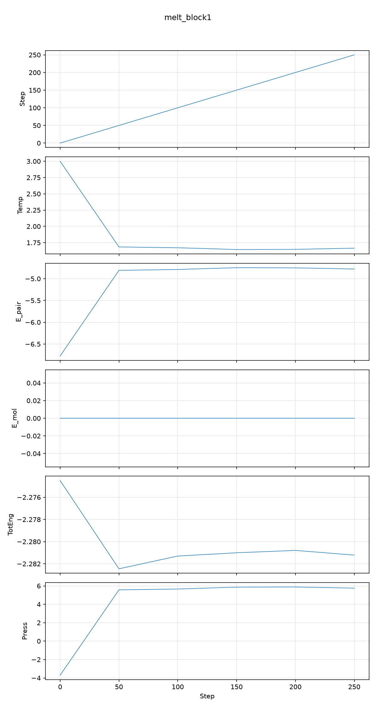</div><div align="center">

**Figure 1. Example of a Generic Plot (Every Column vs Step) for the melt block**
</div>


### Curated Plots

After the generic plots, I made a set of curated plots for each simulation. These curated plots are thus saved in `plots/curated_plots/`

#### Melt

Figures 2 and 3 show the temperature and the total energy against the `Step` for the melt simulation

<div align="center"> 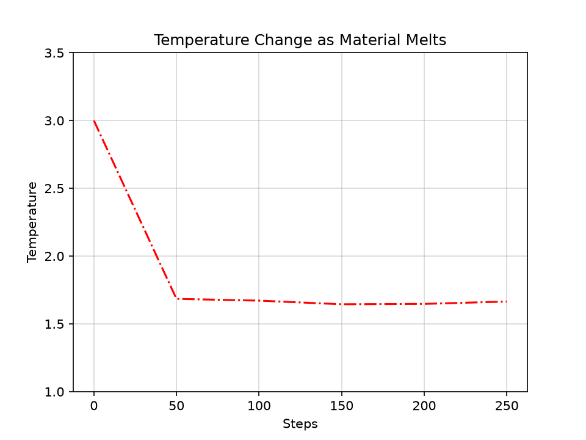</div><div align="center">

**Figure 2. Temperature vs. Step for the melt simulation**
</div><div align="center">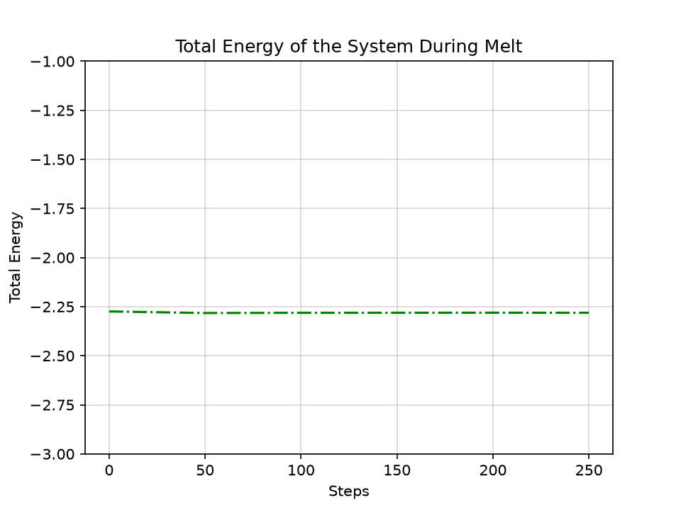
</div><div align="center">

**Figure 3. Total Energy vs Step for the melt simulation**

</div>

As can be seen in Figure 2, the initial temperature is set to 3. The temperature drops to about 1.65 at the end. Essentially, the drop is the lattice melting, the temperature which is a measure of kinetic energy, goes into potential energy as the structure disorders at around step 50. Then the system equilibrates as the temperature equilibrates. It is important to note that thermo output is every 50 steps and the temperature drop happens within the first 50 steps. So drop from 3 to 1.68 is essentially a line between two points.

In Figure 3, the total energy stays the same throughout the simulation at about -2.28. This means that the total energy is conserved which is consistent with a constant energy simulation run. This is indicative of previous assumption that kinetic energy goes into potential energy since the temperature goes down while total energy remains unchanged.

#### Indenter On vs. Off

The `indent` log has two blocks. In the first one the indenter is present, and in the second one it is removed. Essentially, to see the difference in results between indenter's presence. The second run does not start from step 0. It starts at step 30,000, because it continues from the end of the first run and LAMMPS keeps counting steps across `run` commands. Therefore, I plotted both blocks on one continuous step axis (x-axis), so the plots show one trajectory in two phases instead of two separate runs. Figure 4, 5, and 6 show the temperature, total energy and volume.

<div align="center">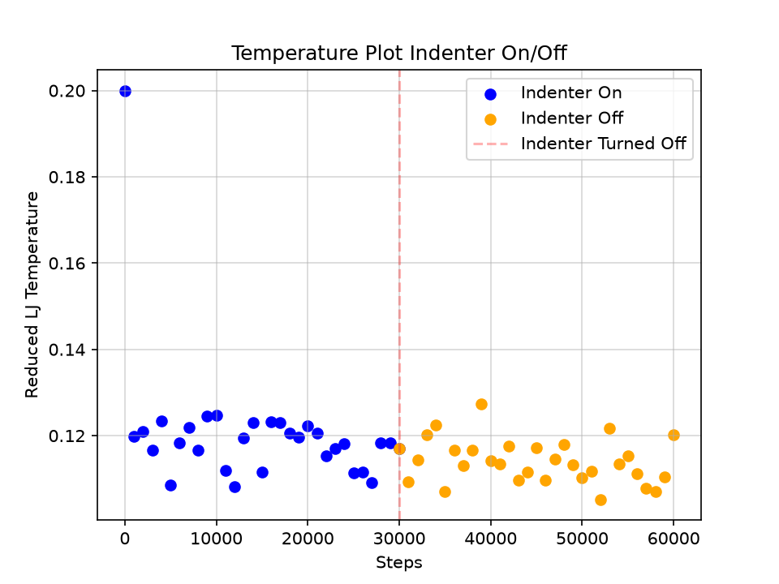</div><div align="center">

**Figure 4. Temperature Plot with Indenter On and Off**
</div><div align="center">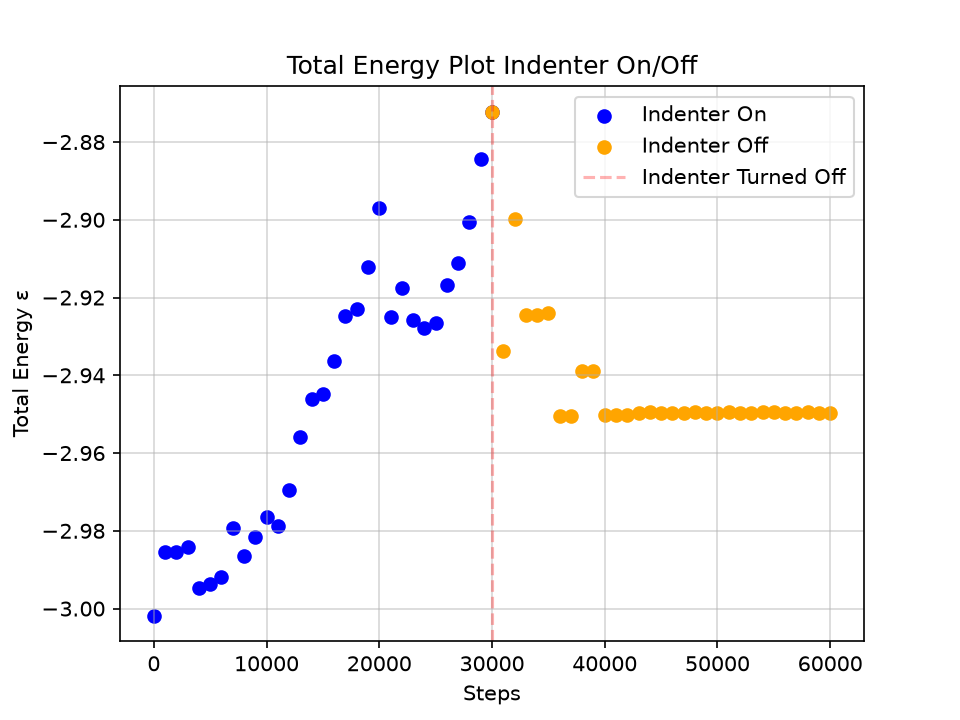</div><div align="center">

**Figure 5. Total Energy Plot with Indenter On and Off**

</div><div align="center">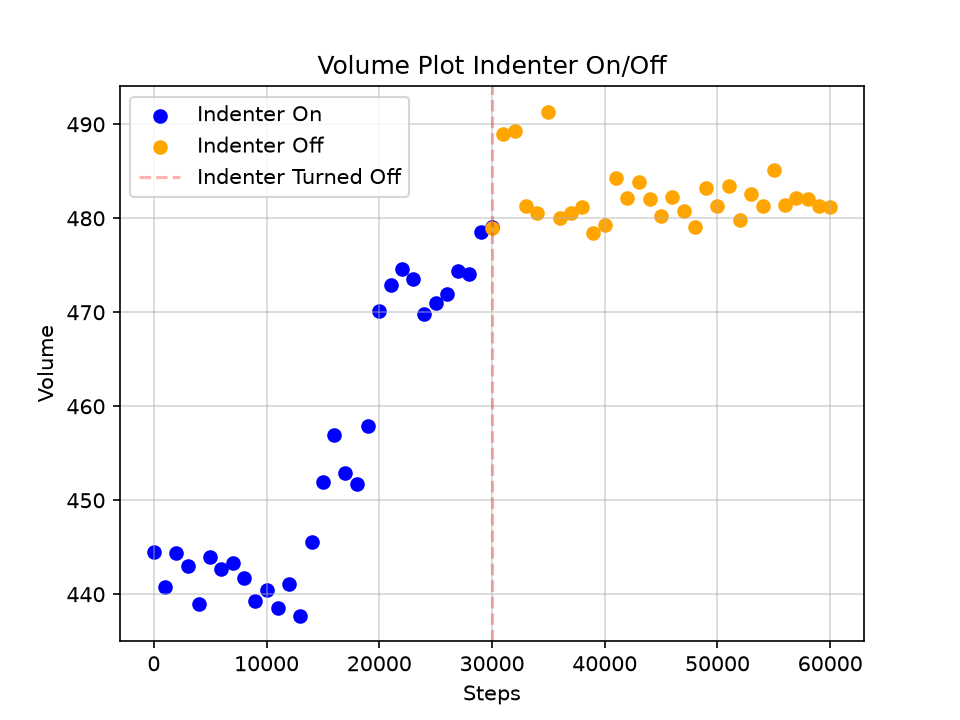</div><div align="center">

**Figure 6. Volume Plot with Indenter On and Off**

</div>

Figure 4 shows reduced Lennard-Jones temperature starting at 0.2 and the temperature falls and settles to about 0.12 at step 1,000. After that, the temperature scatters between 0.105 and 0.127. Looking at the indent.log file, there is a temp/rescale fix, which shows there is a thermostat present. It rescales the velocities every 100 steps to keep the temperature near the target of 0.1 (within a 0.01 window), which explains the initial drop and why the temperature stays flat throughout the simulation, including when the indenter is turned off at step 30,000. Because of this, the temperature does not show the effect of the indenter, and the total energy (Figure 5) is a more informative measure. The plotted temperature likely sits slightly above 0.1 because it is computed for the mobile atoms only (`compute new mobile temp` with `thermo_modify temp new`), while the thermostat acts on all atoms including the frozen lower layer.

Figure 5 shows that indenter presence does affect total energy of the system. With the indenter on, the energy climbs from about -3.00 to -2.87 at step 30,000 which is consistent with the indenter doing work on the system. When the indenter is removed at step 30,000, the energy falls for another 10,000 steps and evens out at -2.95. This is the energy without the indenter present. While it is close, the energy does not return to the initial value of -3.0 which suggests a lasting change in the system when the indenter was present. 

Volume of the indenter simulation is shown in Figure 6. The volume rises in steps from about 440 to 480 when the indenter is turned on. After removal, it initially jumps to 490 before settling near 481 without ever going back to the initial 440 value. However, the volume in this simulation is nuanced. Looking at the `indent.log`, it shows that the boundary is `boundary   p s p`. This means that the LAMMPS simulations fit the atoms as they move in `y` in every step while the `x` and `z` lengths are fixed. This means that volume is the bounding box of the atoms and essentially tracks the vertical spread of the atoms. This vertical extent grew while the indenter pushed in, and it only partly recovers after removal. Moreover, looking at dimensions in the `indent.log` file shows `dimension 2` which means volume in this simulation is basically an area rather than volume as the only change happens in the `y` direction. 


#### Energy vs. Indenter Position

The `indent_min` log has seven blocks. The first one is an initial minimization before the indenter is introduced, and the other six minimize the system with the indenter at various distances: y = 13.0, 12.5, 12.0, 11.4, 11.2 and 11.0. For each of those six blocks I took the final row (the minimized state) and plotted it against the indenter position, which is shown in Figure 7.

<div align="center">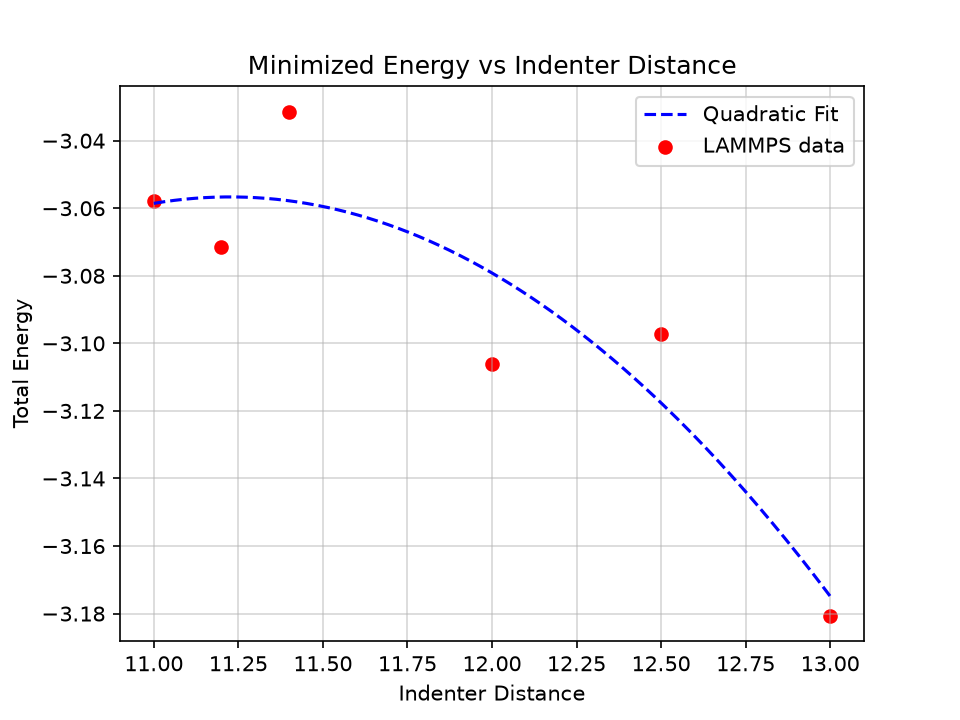</div><div align="center">

**Figure 7. Final energy of each minimization vs indenter position**

</div>

As can be expected, the total energy rises as the indenter moves away from y = 13.0 to 11.0 (from about -3.18 to -3.06). As the indenter gets closer, the atoms are more likely closely packed together which essentially increases the total energy of the system which the figure shows. However, the change in energy is not uniform since minimization settles into a local minimum, thus the highest energy was recorded when indenter was at y = 11.4. Moreover, the quadratic fit is a rough guide for the six indenter position points and shows how energy changes as the indenter is moved closed. 

#### Minimization and Box Relaxation (min_box)

This `min_box` log is the most complex one, with eight blocks. Block 1 is the melt, which is similar to previous atomic melt simulation. Block 2 to 8 are minimizations with different settings (Table 1). Figure 8 shows the convergence of atoms-only minimization (Block 2), and Figure 9 shows the potential energy against the step for block 3 to 8. The x-axes are not shared, because the minimizations converge in very different number of steps.

<div align="center">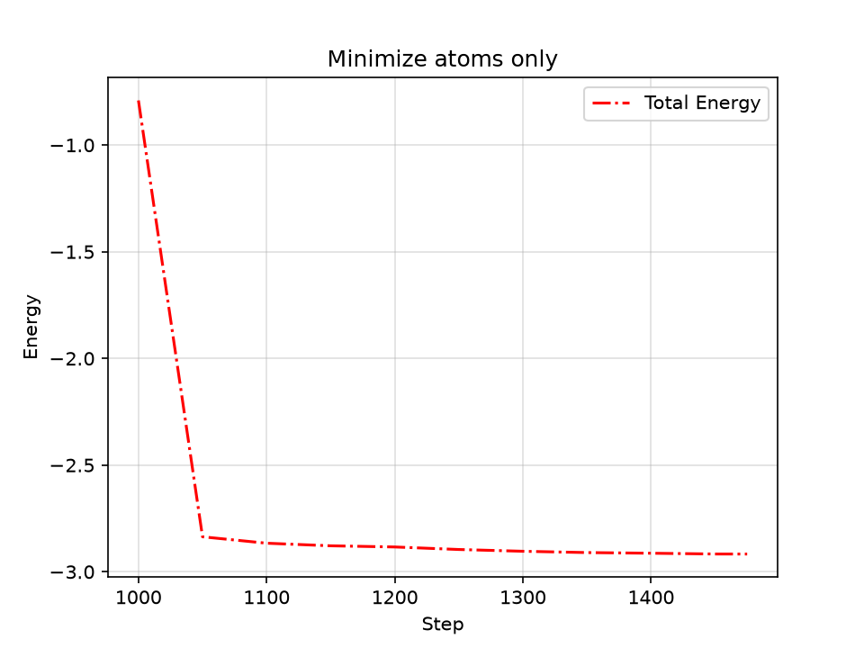</div><div align="center">

**Figure 8. Convergence of the atoms-only minimization (Block 2)**

</div><div align="center">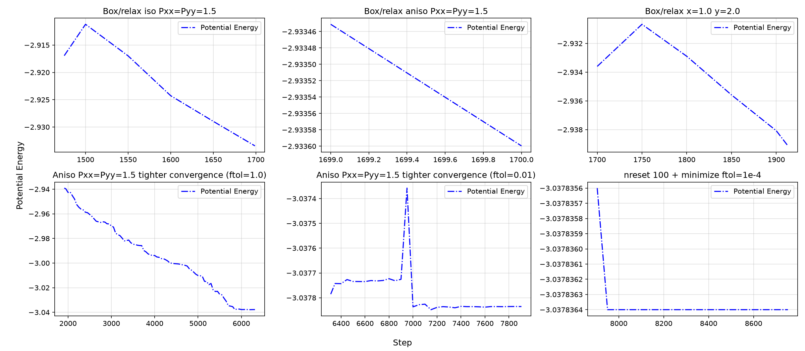</div><div align="center">

**Figure 9. Potential Energy vs. Step for the minimization blocks (Block 3 to 8)**

</div>

Figure 8 is the initial atom minimization is after the block melt simulation and it takes up steps 1,000-1,475. In these steps, the energy falls from the initial value of -0.8 to a final value of -2.9. It is important to note that most of the relaxation after the melt is immediate

In Figure 9, it is initially important to note that each plot has a separate y-axis and they are not comparable across the panels. Block 3 to 5 are box relaxation at different dimensions. This means that during the `box/relax`, the box is changing and the minimized includes the pressure-volume term, so the potential energy does not decrease steadily. Moreover, Block 4 is relatively small since box relaxation changes from `iso` to `aniso` and it starts from block 3’s end state. This results in lower potential energy that converges almost immediately. Block 6 to 8 uses results from Block 5 and tightens the force tolerance (ftol) with Block 4’s settings (anise, 1.5/1.5). Block 6 (ftol = 1.0) results in a long steady decrease from -2.94 and -3.04 in about 4300 steps. Block 7, due to stricter force tolerance (ftol = 0.01), y-axis spans only 0.0004. The potential energy spikes in the middle before minimizing to a value of -3.0378. Similarly, Block 8, with ftol = 10^-4, leads to a similar minimization of -3.03784. Overall, tighter force tolerance gave diminishing returns. Block 6 did most of the minimization, and block 7 and 8 only refines the minimization results.


Additionally, Block 3, 4, and 5 relax the box towards a target pressure with `box/relax`. To see whether the targets were reached, I plotted and compared the final Pxx and Pyy pressure of each block to its target (1.5/1.5 for block 3 and 4, and 1.0/2.0 for block 5). Figure 10 shows this comparison as a grouped bar chart, and Figure 11, 12, and 13 show how the pressure evolved during each block. 

<div align="center">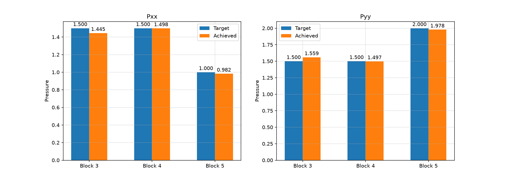</div><div align="center">

**Figure 10. Target vs. Achieved Pxx and Pyy for blocks 3 to 5**

</div><div align="center">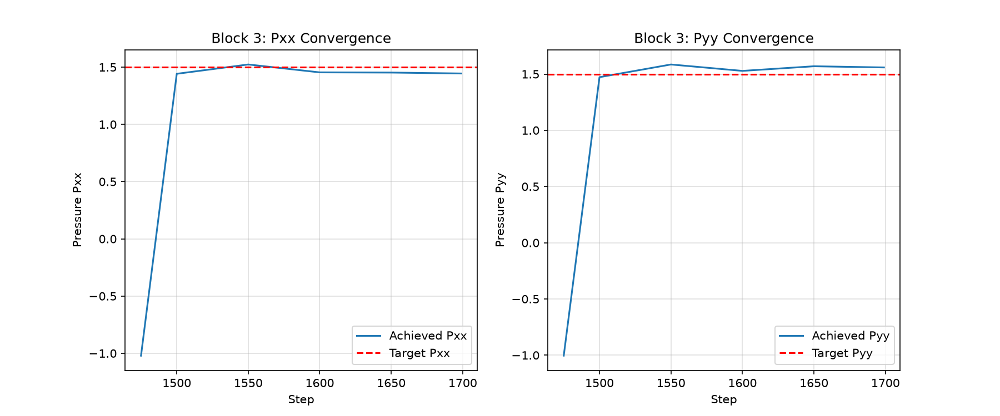</div><div align="center">

**Figure 11. Pressure Convergence for Block 3 (box/relax iso)**

</div><div align="center">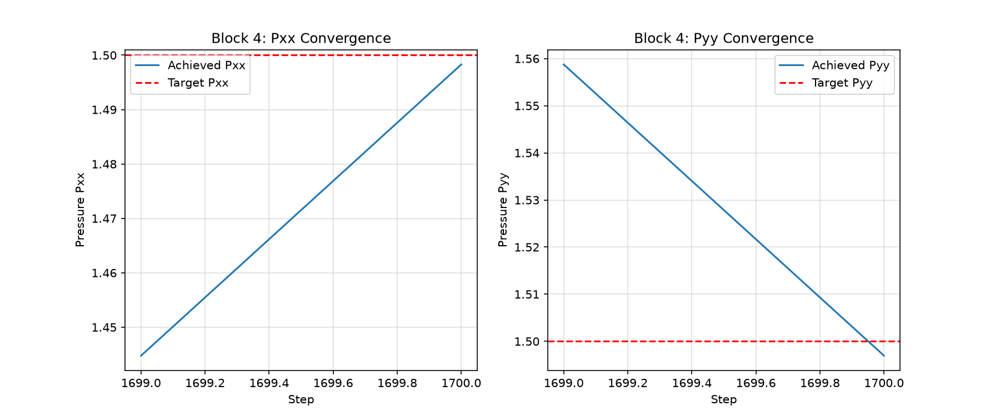</div><div align="center">

**Figure 12. Pressure Convergence for Block 4 (box/relax aniso)**

</div><div align="center">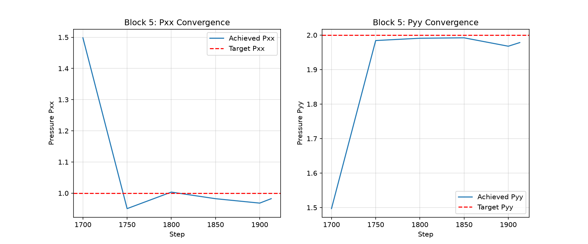</div><div align="center">

**Figure 13. Pressure Convergence for Block 5 (box/relax x=1.0, y=2.0)**

</div>


 In Figure 10, the achieved pressure lands within 0.06 of its target for each of the Block between Block 3-5. Block 4 is the closest, 1.498 and 1.497 vs the target 1.5. On the other hand, Block 3 is the furthest off: Pxx is low (1.445) and Pyy is high (1.559) vs the targeted 1.5. That fits the expected result since Block 3 is `box/relax iso` targeting the average pressure, whereas Block 4 is `box/relax aniso` and can correct x and y better. Lastly, block 5 is also within 0.02 of its target values in both Pxx and Pyy.

 Block 3 pressures in Figure 11 both start at about -1.0 and jump to near 1.5 target value by step 1500 and stays in that region. Pxx stays slightly below and Pyy stays slightly higher than the desired value which matches the bar chart. In this Block 3, there are six data points at about 50-step spacing.

 Figure 12 is the Block 4 pressure convergence. As mentioned before, it has only two values since it starts where Block 3 converged. Pxx goes from 1.445 to 1.498 and Pyy from 1.559 to 1.497. Essentially, this block corrects the leftover error from Block 3. The y-axis is zoomed in making the change look large, but it’s only about 0.05-0.06 for Pxx and Pyy. 

 Figure 13, the Block 5 pressure converges with different x and y values and takes about 210 steps. It starts near 1.5/1.5 pressures, essentially where Block 4 ended. Pxx heads towards 1.0 and Pyy towards 2.0 and both are near their target values at about step 1750. Pxx initially goes to about 0.95 and goes up to within a few percent of the target value. The Pxx value ends at 0.982 and Pyy ends at 1.978. It is also important to note that the minimization for Block 5 stops when the specified tolerance is met and not the exact target value. Therefore, the final Pxx and Pyy value is not the exact target value.

## Conclusion

Overall, this project built a pipeline for LAMMPS log files that are messy, convoluted, and not uniformly structured. First, a bash script organizes the raw LAMMPS files, an awk script finds every thermo block by its start and end markers and writes it to its own CSV. Then a summary script checks the result, and Python script plots every block as well as a set of curated plots that compare different blocks. Additionally, a driver script runs all of it with one command called `run_pipeline.sh`. The main point is that the parser works from the structure of the file, so it handles the changing columns, and the physical meaning of each block is kept in a separate labels file. 

However, there are some limitations in the scripts. In this project, only four serial examples were used, and every new log needs a new entry in the filename map in `organize.sh` and rows in `block_labels.csv`. In the future, the parallel (`.4`) runs of the same examples could be parsed as well, to confirm that the physics matches between serial and parallel runs. Lastly, the pipeline could also be scheduled with `cron`, and tested on the output of my own simulations instead of the example logs obtained through LAMMPS github repo.
